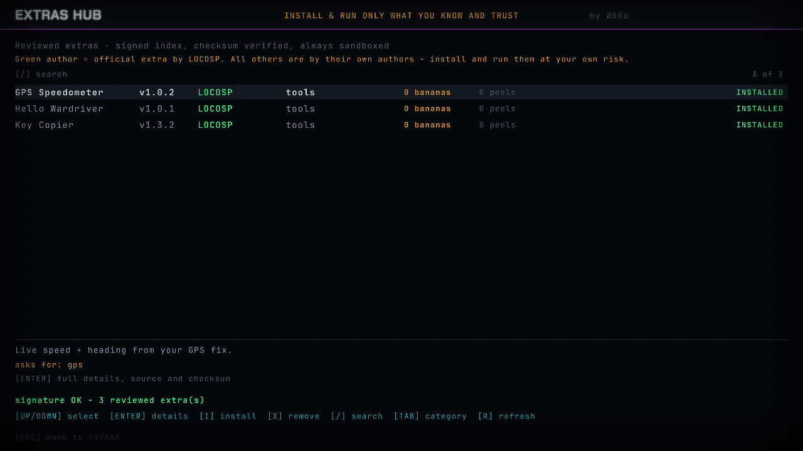
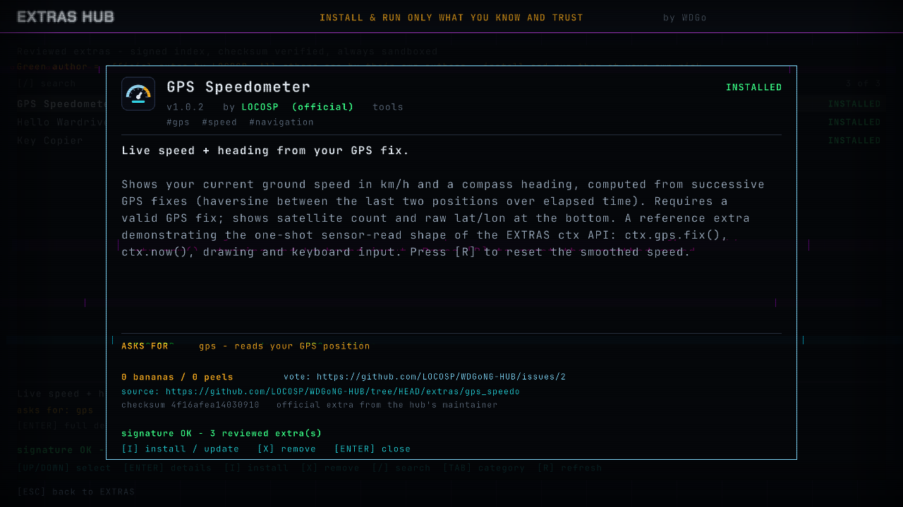

# WatchDogsGo NG

<div align="center">


<p>


</p>
<p>
<a href="https://github.com/LOCOSP/projectZero"></a>
<a href="https://github.com/LOCOSP/WDGWMarauderV8"></a>
<a href="https://locosp.github.io/WDGoNG-HUB/"></a>
<a href="https://wdgwars.pl"></a>
</p>
<p>


</p>

</div>

**The newest generation of the open-world hacking Real Life Game (RLG): a handheld where the real
wireless networks around you become the game. Scan the city, wardrive and run
live ops like it's Watch Dogs.**

You carry it in the field. Your GPS is the player, the Wi-Fi / BLE / LoRa devices
around you are the map, and real reconnaissance, wardriving and attacks are the
gameplay — scored with XP, hacker ranks and badges, all behind a cyberpunk game UI.

> **⚠️ For authorized security testing, research and education only.**
> It drives real radios and can scan, capture, disrupt and impersonate wireless
> networks and devices. Use it **only** on equipment you own or are explicitly
> permitted to test. You are solely responsible for how you use it — see
> [Legal & responsible use](#legal--responsible-use). No warranty, no liability.

---

## Contents

- [What it is](#what-it-is) · [Screenshots](#screenshots) · [Hardware](#hardware)
- [Install](#install) · [Running](#running) · [Controls](#controls) · [Updating](#updating)
- [Connect to WDGWars](#connect-to-wdgwars-api-key--pairing) · [Flashing firmware](#flashing-the-esp32-firmware)
- [Cluster Wardrive](#cluster-wardrive--the-node-fleet) · [What it talks to](#what-it-talks-to--integrations)
- [Features](#features) · [Extras](#extras--mini-apps-and-the-hub)
- [Loot: backup, restore, move](#loot--backup-restore-and-moving-to-a-new-device)
- [Configuration & hardware overrides](#configuration--hardware-overrides)
- [Data & privacy](#data--privacy) · [Legal & responsible use](#legal--responsible-use) · [License](#license)

---

## What it is

WatchDogsGo NG turns a ClockworkPi uConsole + an ESP32-C5 radio into a portable
pentest and signals-intelligence rig that plays like a game:

- **A live map centered on you** (real GPS). Discovered networks are plotted around
  you; walk the city and the map fills in.
- **Real tooling, game loop.** Every scan, handshake, evil-twin and wardrive is a
  real action against real RF — it just earns XP, ranks and badges while it runs.
- **Online metagame.** Links to the **WDGWars** community — upload your wardriving,
  climb a ranking, chase objectives on the map.

---

## Screenshots

| | |
|---|---|
|  |  |
| **EXTRAS hub** — browse reviewed, signed, always-sandboxed mini-apps; official LOCOSP extras shown in green, with ratings and search. | **Extra details** — icon, tags, the permissions it asks for, ratings, source and checksum, with the catalogue signature verified. |

---

## Hardware

**Required**

- **ClockworkPi uConsole** (CM4 / CM5) — or any Raspberry Pi OS / Debian / Ubuntu Linux box.
- **ESP32-C5** radio on USB — Seeed **XIAO ESP32-C5** (no SD, USB-JTAG) or an ESP32-C5
  **WROOM** dev kit — running the **[projectZero / JanOS](https://github.com/LOCOSP/projectZero)**
  firmware (flashable from inside
  the app, see below).

**Optional (unlock more features)**

- GPS (AIO v2 UART, USB GPS, or `/dev/ttyAMA0` / `/dev/ttyS0`) — for the live map & wardriving.
- LoRa SX1262 (SPI) — MeshCore messenger + WDGWars LoRa chat.
- RTL-SDR dongle — ADS-B radar, 433 MHz scanner, emergency-services radio.
- A monitor-mode USB Wi-Fi card (e.g. an **AC1200 / RTL8812AU**) — host-side Wi-Fi scan /
  wardrive / handshake / deauth as a second radio alongside (or instead of) the ESP32.
- Bluetooth (host `hci0`) — proximity radar, BLE HID.
- uConsole **AIO v2** board — software-switched power rails for GPS / LoRa / SDR / USB.

---

## Install

**One-liner** (uConsole / Raspberry Pi OS / Debian / Ubuntu):

```bash
curl -sL https://locosp.github.io/WDGoNG/install | sudo bash
```

**Or clone it yourself:**

```bash
git clone https://github.com/LOCOSP/WDGoNG.git ~/python/WDGoNG
cd ~/python/WDGoNG
bash setup.sh          # creates the venv, installs everything (apt + pip), builds dump1090
```

`setup.sh` is idempotent — re-run it any time; it skips what's already present.

---

## Running

```bash
./wdgong_ui/run_ui.sh          # or double-click the "WatchDogsGo NG" desktop icon
```

The launcher auto-detects the ESP32 serial port, powers the AIO USB rail, stops
`meshtasticd` (which holds the SPI bus), and **self-heals dependencies** — if a core
module is missing it runs `setup.sh` for you before starting. It runs under `sudo`
for serial / GPIO / raw-socket access.

### Controls

**Global keys** (work almost everywhere):

| Key | Action |
|---|---|
| **`TAB`** | open / close the menu (and the node panel on mesh / cluster screens) |
| **←/→** · **↑/↓** | switch tab · move item (or pan a value on sub-screens) |
| **ENTER** / item's **letter** | run the selected (or lettered) menu item |
| **+ / −** · **0** | map zoom in / out · reset to DISTRICT (zoom-out stops when the map fills the screen) |
| **H** | expand ⇄ shrink the 433 Hunter / Capture panel |
| **`` ` ``** or **L** · **P** | loot screen · captured-credentials screen |
| **G** · **F** | FIELD view · fullscreen toggle |
| **S** | hard **STOP** — halt every scan / attack / radio at once |
| **U** · **ESC** | game-update screen · quit prompt (power modules off / leave / restore) |

**Context keys** (only on the screen named):

| Screen | Keys |
|---|---|
| **LoRa Mesh chat** | **Ctrl+T** flip MeshCore ⇄ Meshtastic · **←/→** cycle band/region |
| **Cluster fleet** | **↑/↓** select node · **←/→** pin a node's band · **A** adopt a join request · **X** stop the fleet |
| **ADS-B tracks map** | **A** toggle aircraft tracks · **K** export the current view to KML · **C** cycle coverage overlay |
| **433 Hunter** | **K** learn the fob in the target window · **J** reset the target to the car-key default |
| **Map markers** | **C** cluster-select (step through grid-clustered markers) |

### Leaving — the quit screen

Press **ESC** to quit. If any radio is still powered, the prompt lists the
active modules (**GPS / LoRa / SDR**) and asks what to do with them:

- **`Y` OFF & QUIT** — stop every scan / attack and power those rails down.
- **`L` LEAVE ON** — quit but leave them running (a background Meshtastic
  daemon or an SDR capture keeps going after the game exits).
- **`R` RESTORE PRE-LAUNCH** — put the rails back to exactly how they were
  when you launched the game (shown only when something actually changed).
- **`N`** — cancel and go back.

The **USB** rail is never touched — it powers the ESP32-C5, so the game always
keeps it on. Your loot on the SD card is safe whichever you pick.

---

## Updating

**In-game (recommended):** `SYSTEM → Update Game`. It does a `git pull --ff-only` and
restarts itself. Your data is never touched — `loot/` (XP, sessions, handshakes, chat),
`secrets.conf` and the venv are all gitignored. (The pull runs as your login user so it
can reach the repo over SSH even though the app runs as root.)

**Manual:**

```bash
cd ~/python/WDGoNG && git pull --ff-only && ./wdgong_ui/run_ui.sh
```

> Don't download a ZIP over the folder — that breaks the git checkout and leaves stale
> files. Updates are always a `git pull` (only changed code is replaced).

---

## Connect to WDGWars (API key / pairing)

[WDGWars](https://wdgwars.pl) is the community metagame — upload your wardriving, climb
the ranking, chase objectives on the map. Link your device in **one** of two ways:

**A) Pair with a code (easiest — no typing a 64-char key):**
`ADDONS → WDGWars Pair`. Register / log in at [wdgwars.pl](https://wdgwars.pl), open the
device-pairing page, and enter the short code the game shows. The key is fetched and stored
for you.

**B) Paste the API key manually:**

1. Register at [wdgwars.pl](https://wdgwars.pl); you get a **64-character hex API key**.
2. Copy the template and add the key:
   ```bash
   cp secrets.conf.example secrets.conf
   chmod 600 secrets.conf
   nano secrets.conf          # set:  WARDRIVE_API_KEY=your-64-char-hex-key
   ```
3. Restart the game. `secrets.conf` is **gitignored** — it never leaves your device and
   updates never touch it.

Running your own server? Also set `WARDRIVE_API_URL=https://your-server/api/upload/`.
The same `secrets.conf` holds the optional **WPA-sec** and **WiGLE** keys (see the template for each).

---

## Flashing the ESP32 firmware

The radio runs the **[projectZero / JanOS](https://github.com/LOCOSP/projectZero)** firmware
(our public ESP32-C5 fork). You flash and update it from inside the app — no cables-and-IDE dance.

- **`SYSTEM → Flash ESP32`** → pick your board:
  - **XIAO ESP32-C5** — auto-reset over USB-JTAG (no BOOT button; the AIO USB rail is
    power-cycled for you).
  - **ESP32-C5 WROOM** — standard dev-kit reset.
- The app downloads the **latest firmware release** from GitHub and flashes it with
  `esptool` at the right offsets (bootloader `0x2000`, partition table `0x8000`,
  app `0x20000`), then the radio reboots.
- **Auto-check:** the app reads the firmware version over serial and shows a pulsing
  **`[FW] update available`** banner when a newer release is out — one click to flash it.

---

## Cluster Wardrive — the node fleet

Instead of one radio hopping 40 channels, **Cluster Wardrive** turns the XIAO embedded in
your uConsole into the **core of an ESP-NOW node fleet**: a swarm of XIAO / T-Dongle C5
nodes each sweep a slice of the band at once and stream their hits back to you. The host
merges, de-dups, GPS-stamps and scores everything into your normal loot — you just get the
whole spectrum covered in parallel.

### How it works (host-brain architecture)

The intelligence lives on the **uConsole, in Python** — not in the firmware:

- **The XIAO is a thin ESP-NOW bridge** (a "dumb pipe"): it only relays frames on and off
  the air and over USB serial. It holds no fleet secret and no protocol logic.
- **The brain is the host** (`wdgong_ui/cluster_*.py`): authentication, the node registry
  and identity, channel-slice assignment, BLE-duty election, de-dup, GPS stamping and node
  adoption all run here. The wire format is documented in
  [`docs/cluster-serial-protocol.md`](docs/cluster-serial-protocol.md).

That split is deliberate: the public firmware binary reveals nothing about how the fleet
is coordinated — all of that is host-side.

### Requirements

- **Bridge firmware** on the uConsole's XIAO: **[projectZero / JanOS](https://github.com/LOCOSP/projectZero) ≥ 1.7.5**
  (adds the ESP-NOW bridge mode). Flash it from `SYSTEM → Flash ESP32` like any update.
- **Fleet key** at **`~/.wdgo/fleet.key`** (16 raw bytes) — the shared secret the whole
  fleet signs its frames with. It is **gitignored and never committed or logged**; put the
  same key your nodes already use there. Without it the host can still hear nodes but can't
  command adopted ones. (Override the path with `WDGO_FLEET_KEY=/path/to/key`.)
- **Nodes** running the **[WDGWMarauderV8](https://github.com/LOCOSP/WDGWMarauderV8)** node
  firmware (the Marauder V8 fleet node — WiFi 2.4/5 GHz + BLE + GPS), already carrying that fleet
  key, on the same control channel. Nodes do not need reflashing to join an existing fleet.

### Running it

Launch the game normally and open **SNIFF → *Cluster Wardrive***. The bridge path is the
**default whenever the fleet key is present** — no environment flags needed. The fleet
starts, nodes latch onto the core, dump their buffered records, and the hits flow into your
loot (`wardriving.csv`, XP, map) exactly like a normal wardrive. GPS-stamped when you have a
fix; **indoors with no fix the hits are still logged** and placed on the map once a fix lands.

### The fleet screen

| Key | Action |
|---|---|
| **↑ / ↓** | select a node in the health table |
| **← / →** | set the selected node's scan band: **AUTO → 2.4G → 5G → 5G-lo → 5G-hi** (a manual pin; the rest auto-split around it) |
| **A** | adopt a node that is requesting to join the fleet |
| **X** | stop the fleet core |
| **ESC** | hide the screen — **the fleet keeps collecting in the background**; re-open it any time |
| **S** | hard STOP everything, the fleet included |

- **Coverage radar** (left): each node sits at the centre of the channel slice it scans, so
  the ring reads as real spectrum coverage and an uncovered gap is visible at a glance.
- **Summary tiles**: nodes online, fleet records/min, records this run, **WiFi nets** and
  **BLE devices** (counted separately).
- **Per-node health table**: role, channel slice (a `*` marks a manual pin), records/min,
  de-dup fill, on-die temperature, uptime, drop-outs and a state badge.

### Channels, roles & one radio

- **Automatic by default**: the brain splits the whole 2.4 GHz + 5 GHz channel set into
  contiguous slices, one per WiFi node, and re-balances as nodes come and go.
- **BLE duty**: with two or more nodes, one is always kept on **Bluetooth**; the choice is sticky.
- **Manual override**: pick a node and press **←/→** to pin its band; the rest auto-split around it.
- **One radio**: the XIAO has a single radio, so the fleet core and a normal capture can't run
  at once. Starting any scan / wardrive / sniffer / attack automatically **yields the radio and
  stops the fleet** (`[CLUSTER] yielding the radio…`).

### No hardware? Simulator

`WDGO_CLUSTER_SIM=1` synthesises a realistic fleet straight into the UI so you can explore
the whole screen — telemetry, coverage, a join request, the live record stream — with no
nodes attached. The demo never writes to your real loot / XP.

---

## What it talks to — integrations

WatchDogsGo NG is a hub for a lot of real hardware. What it auto-detects and drives:

| Device | Over | What you get |
|---|---|---|
| **ESP32-C5** (XIAO / WROOM, [projectZero/JanOS](https://github.com/LOCOSP/projectZero)) | USB serial | Wi-Fi + BLE scan, wardrive, sniffer, handshake, deauth, evil twin, SAE flood |
| **[WDGWars Marauder V8](https://github.com/LOCOSP/WDGWMarauderV8) node fleet** (XIAO / T-Dongle C5) | ESP-NOW bridge → USB | [Cluster Wardrive](#cluster-wardrive--the-node-fleet) — many radios sweep at once |
| **[Flipper Zero](https://flipperzero.one)** | USB CDC (auto-detect `0483:5740`) | SubGHz RX/TX, NFC, device info, storage — and `.sub` RAW files the 433 Capture tool writes are Flipper-ready |
| **Monster RF SubGHz** (CC1101) | USB serial (CH340) | sub-GHz capture / replay on a dedicated board |
| **RTL-SDR** (R820T etc.) | USB | ADS-B radar + tracks, 433 MHz scanner, 433 Hunter fox-hunt, 433 Capture, emergency-services radio |
| **LoRa SX1262** | SPI | MeshCore + native Meshtastic mesh chat, node mapping, WDGWars LoRa chat |
| **AC1200 / RTL8812AU** monitor-mode Wi-Fi card | USB (`iw` / monitor) | host-side Wi-Fi scan / wardrive / handshake / deauth as a second radio |
| **PipBoy / ESP32-S3 watch** | BLE | companion watch integration (work in progress) |
| **uConsole AIO v2** | GPIO rails | software power switching for GPS / LoRa / SDR / USB |

With both an ESP32 and a host Wi-Fi card present, **`SYSTEM → Radio (WiFi card)`** gives you a
per-function matrix (scan / wardrive / handshake / deauth / BLE → ESP32 / host / auto) so you
choose which radio serves what, or let `auto` keep the ESP32 as primary.

---

## Features

### The map & your progression

- Live **GPS map** centered on you; discovered Wi-Fi/BLE plotted as geographic markers,
  grid-clustered as you zoom; a gorilla-operator avatar marks your position.
- **Offline world basemap** — a bundled whole-world, ctOS-styled map renders under the
  markers; **fully offline, anywhere on Earth**. Zoom out to a regional/world view; zoom in
  **DISTRICT → STREET → BLOCK**.
- **XP, hacker ranks & badges** — ranks climb `NOOB → … → GHOST → ZERO_DAY → … → FINAL_BOSS`.
- **WDGWars account chip** in the top bar when linked.

### Recon — SCAN & SNIFF

- **WiFi Scan**, **BLE Scan**, **BT Tracker** (follow a MAC), **AirTag Scan**.
- **WiFi / BT Wardrive** — continuous, firmware-streamed capture in **WiGLE 1.6** format.
- **Cluster Wardrive** — the ESP-NOW fleet core (see its section above).
- **Packet Sniffer**, **Handshake Capture** (plus a no-SD serial variant that streams the
  PCAP straight to the host).

### Attacks — ATTACK

- **Deauth** (targeted) · **Blackout** (all-channel) · **Evil Twin** (clone an SSID, serve
  a captive portal, capture credentials) · **SAE Flood** (WPA3) · **Evil Portal** ·
  **Dragon Drain** (WPA3 SAE flood, host-side) · **MITM** (ARP spoof + capture).
- **BlueDucky** / **RACE Attack** — BLE HID injection & Airoha exploit (work-in-progress).

> Use only against your own networks / devices or where you are explicitly authorized.

### Radios & add-ons — ADDONS

- **LoRa Mesh** — one entry for both stacks: **MeshCore** and native **[Meshtastic](https://meshtastic.org)**, under a
  single picker (stack → region / band → preset), a shared chat and a node panel on **TAB**.
  Every node the radio hears is saved to loot (deduped, uploaded to WDGWars) and, if it
  advertised a position, drawn on the map — MeshCore as a purple diamond, Meshtastic as a
  green hex. On a single SX1262 only one stack listens at a time, so **Ctrl+T** in the chat
  flips MeshCore ⇄ Meshtastic (and **←/→** cycles the band). If the **LoRa rail is already
  powered** when the game starts, the last-used configured stack auto-resumes in the
  background; if nothing is configured the radio idles, and if the rail is off nothing
  mesh-related starts.
- **WDGWars Chat** ([Reticulum](https://reticulum.network) / LXMF, over the TCP hub or LoRa).
- **RTL-SDR tools** — **ADS-B Radar** (live aircraft + track log + KML export), **433 MHz
  Scanner**, **Emergency Radio** (fire VHF / police TETRA detector), **433 Hunter** (fox-hunt
  a 433 MHz fob with a live RSSI bar + spectrum and a closing-in beep), **433 Capture** (record
  every 433 MHz signal to raw `.cu8` + a decoded log + a Flipper-ready RAW `.sub`).
- **Flipper Zero**, **Monster RF SubGHz** (CC1101), **PipBoy Watch** (ESP32-S3 watch).
- **Proximity Radar** — sense other WDGWars players nearby over BLE. Proximity is a **shared
  protocol across the WDGW firmware family** (uConsole, Marauder V8, the Badger 2350 badge, and
  more), so the gear recognises its own in the field — using a **rotating, privacy-preserving
  identity**: devices can tell "this is WDGW" without exposing who you are or letting anyone
  track a specific person.

### WDGWars online — ADDONS

- **WDGWars Sync** — upload your wardriving / ADS-B / MeshCore loot to the community server.
- **WDGWars Pair** — link this device to your account with a short code.
- **Chase the White Rabbit** — portal objectives drawn on your map, with an edge-of-screen
  arrow + distance to the nearest off-screen target.
- **Game-state HUD** — your uConsole ranking, team, decaying territory tiles and active
  contracts, pulled live and shown on the map.
- **Unique device identity** — each uConsole gets a stable per-board name
  (`<account>-uConsole-<hwid>`) used on chat, mesh and the portal.

### Loot & data — see [backup / restore](#loot--backup-restore-and-moving-to-a-new-device)

- **Loot screen** (`` ` `` / **L**): an all-time stats dashboard **plus a SESSION LOG
  journal** — browse every capture session by date like a case drawer and preview any file.
- **[WPA-sec](https://wpa-sec.stanev.org)** upload / download — submit handshakes for distributed cracking and pull back
  cracked passwords (honest per-handshake accounting).
- **Backup / Restore** — one-file export of all your data.

### System — SYSTEM

Hardware toggles (**GPS / LoRa / SDR / USB** power rails), **Radio (WiFi card)** matrix,
**Whitelist** (ignore your own MACs), **Reboot ESP32**, **Flash ESP32**, **Update Game**,
**Backup / Restore Data**, **Session Data** (browse/delete loot sessions), **Captured Data**
(Evil Twin / portal credential history), **Upload WPA-SEC / WiGLE**.

---

## Extras — mini-apps and the hub

**Extras** are self-contained mini-apps that run inside the game, in their own tab. They can
draw to the screen, read input, and (with permission, if the hardware is present) read GPS,
read/write loot and use per-extra storage — all through a small `ctx` facade. Third-party
extras run **sandboxed** in a separate, non-root process: they never touch your files directly
and only exchange draw-ops and permitted data over IPC.

- **Install / browse:** `EXTRAS` tab in the game → the **hub** lists available extras with a
  rating (🍌 = yes, 🍑 peel = no), search, screenshots and an install button. Official extras
  (author **LOCOSP**, shown in green) are made by LOCOSP; everything else is written by its own
  author. A place in the hub means an extra was reviewed, not that it is endorsed — **install
  and run only extras you understand and trust.**
- **The public hub:** <https://locosp.github.io/WDGoNG-HUB/> (repo
  [`LOCOSP/WDGoNG-HUB`](https://github.com/LOCOSP/WDGoNG-HUB)). Catalogue entries are signed
  offline with a hardware key, so the game can verify what it installs.

### Want to write one?

Start with the bundled example **`hello_wardriver`** (it explains itself on first run), then:

- **[docs/EXTRAS_authoring.md](docs/EXTRAS_authoring.md)** — the practical guide: folder layout,
  `extra.json` manifest, the entry module & lifecycle, the `ctx` API, images and the icon.
- **[docs/EXTRAS_spec.md](docs/EXTRAS_spec.md)** — the full spec: the security model, the two
  trust tiers, exclusive-hardware leases, and the permission broker.
- **[docs/EXTRAS_hub.md](docs/EXTRAS_hub.md)** — how to submit an extra to the hub and how it is
  reviewed and signed.

You develop an extra against a local examples folder (`WDGO_EXTRAS_EXAMPLES=/path`), then open a
PR to the hub when it's ready.

---

## Loot — backup, restore, and moving to a new device

Everything you earn and capture lives under **`loot/`** (XP, badges, sessions, handshakes,
cracked passwords, wardriving CSVs, chat identity) and your keys live in **`secrets.conf`**.
Both are **gitignored** — updates never touch them and nothing is committed.

**Back up (one file):** `SYSTEM → Backup / Restore Data → Export`. It writes a single archive
to your home directory:

```
~/wdgo-backup-<YYYY-MM-DD_HH-MM-SS>.tar.gz     # contains loot/ + secrets.conf
```

**Restore on the same device:** `SYSTEM → Backup / Restore Data → Restore`. It restores the
**newest** `~/wdgo-backup-*.tar.gz`, keeps the data it replaced at `loot.pre-restore/` as an undo,
and restarts the game.

**Move to a new install / new uConsole:**

1. On the old device: **Export** (step above).
2. Copy the archive to the **home directory** of the new device, e.g.
   `scp ~/wdgo-backup-*.tar.gz user@new-box:~/`.
3. Install the game on the new device ([Install](#install)).
4. In the game: **Restore** — it picks up the newest `~/wdgo-backup-*.tar.gz` and relaunches.

> Prefer to do it by hand? Just copy the `loot/` folder and `secrets.conf` into the new
> checkout before first launch — that's all the game keeps.

A lightweight periodic auto-backup of the loot DB also runs in the background while you play,
so a crash can't lose your stats.

---

## Configuration & hardware overrides

Most things auto-detect. When your wiring differs, override via `secrets.conf` (API keys) or
environment variables (device paths — set them in your shell or at the top of
`wdgong_ui/run_ui.sh`).

**API keys — `secrets.conf`** (copy `secrets.conf.example`):

| Key | For |
|---|---|
| `WARDRIVE_API_KEY` / `WARDRIVE_API_URL` | WDGWars upload (64-char hex key; URL only if self-hosting) |
| `WDG_WPASEC_KEY` | WPA-sec handshake upload / cracked-password download |
| `WDG_WIGLE_NAME` / `WDG_WIGLE_TOKEN` | wigle.net wardriving upload |

**Device paths & behaviour — environment variables:**

| Variable | Default | Effect |
|---|---|---|
| `WDGO_PORT` | auto-detect | Force the ESP32 serial port (e.g. `/dev/ttyACM0`). Auto-detect scans `ttyUSB*` / `ttyACM*` and prefers native-USB (XIAO) over a CH340 (Monster RF). |
| `WDG_GPS_DEVICE` | `/dev/ttyAMA0` | GPS serial device. The uConsole's built-in GPS is the mini-UART — pin it with `WDG_GPS_DEVICE=/dev/ttyS0`. Auto-probe also tries `ttyUSB*` / `ttyACM*` / `ttyAMA*` / `ttyS0`. |
| `WDG_GPS_BAUD` | `9600` | GPS baud rate. |
| `WDGO_FLEET_KEY` | `~/.wdgo/fleet.key` | Path to the 16-byte Cluster fleet key. |
| `WDGO_CLUSTER_SIM` | off | `=1` runs the Cluster screen against a simulated fleet (no hardware, no real loot writes). |

The ESP32 serial is always **115200 8N1**. If a second ESP32-C5 (e.g. Monster RF on a CH340)
is present, the game keeps the native-USB board for Wi-Fi/BLE and leaves the CH340 to the
sub-GHz manager — pin with `WDGO_PORT` if your setup is unusual.

---

## Data & privacy

Your data lives under `loot/` and `secrets.conf`. Both are gitignored and never go into the
game's repo — updates (`git pull`) never touch them.

**Nothing leaves the device unless you configure it.** With no API keys and no linked
account, everything stays local. What *can* leave, and exactly when:

- **Wardriving data** — your networks and their positions (`wardriving.csv`) go to WiGLE
  and/or WDGWars once you add keys and upload, **including automatically when a cluster
  session stops**.
- **Captured WPA handshakes** — go to the WPA-sec cracking service, but **only when you
  run `Upload WPA-SEC` yourself**.
- **Live location** — if you link WDGWars and have a GPS fix, the game sends your current
  coordinates to the WDGWars map **about every 45 seconds** so others can see you, plus
  ADS-B and MeshCore sightings during a sync.

Captured credentials and any other loot stay on the device unless you upload the data
above. Keep your keys private with `chmod 600 secrets.conf`.

---

## Legal & responsible use

WatchDogsGo NG drives real radio hardware and includes tooling that can scan,
capture, disrupt and impersonate wireless networks and devices. It is built for
security research, education and authorized testing.

**Only use it on equipment you own, or where you have explicit, written permission
from the owner.** Scanning or attacking networks and devices without authorization
is illegal in most jurisdictions, as is transmitting on frequencies or at power
levels you are not licensed for. Knowing and following the law where you operate
is your job, not the software's.

**No responsibility.** The author (LOCOSP) and contributors accept no liability for
any use or misuse of this software, or for any damage, data loss, legal consequence
or other harm that results from it. Everything you do with WatchDogsGo NG, you do
on your own responsibility and at your own risk.

**No warranty.** The software is provided "as is", without warranty of any kind,
express or implied, including fitness for a particular purpose.

**Extras.** Extras marked official in the hub (author LOCOSP, shown in green) are made
by LOCOSP. All other extras are written by their own authors, not by LOCOSP. A place in
the hub means an extra was reviewed, not that it is guaranteed safe or endorsed. **Install
and run only extras you understand and trust** — you do so at your own risk.

**Don't be a skid.** This is a tool for learning how wireless systems work and for
testing what you are allowed to test. Pointing it at strangers' networks, public
infrastructure or anyone who did not agree to it is not hacking; it is just being a
nuisance with someone else's code, and it gets tools like this banned for everyone.
Learn the protocols, break your own lab, report what you find responsibly.

---

## License

WatchDogsGo NG is **source-available** under the **PolyForm Noncommercial License 1.0.0**
(see [`LICENSE`](LICENSE)): you may use, study, modify and share it for any **noncommercial**
purpose — **commercial use is not permitted**. The supported way to extend it is to **write an
extra** and publish it through the [hub](#extras--mini-apps-and-the-hub); see the extras docs
to get started.
